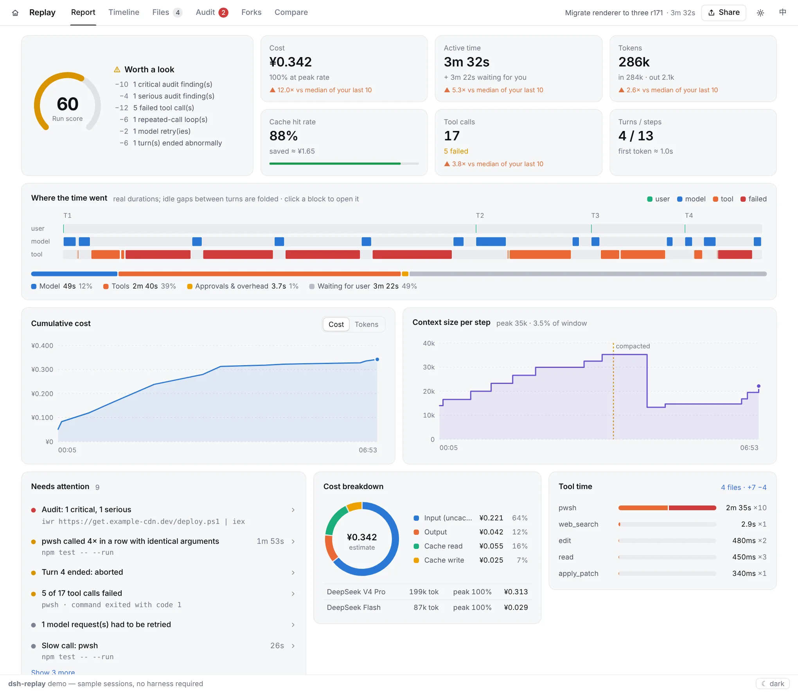
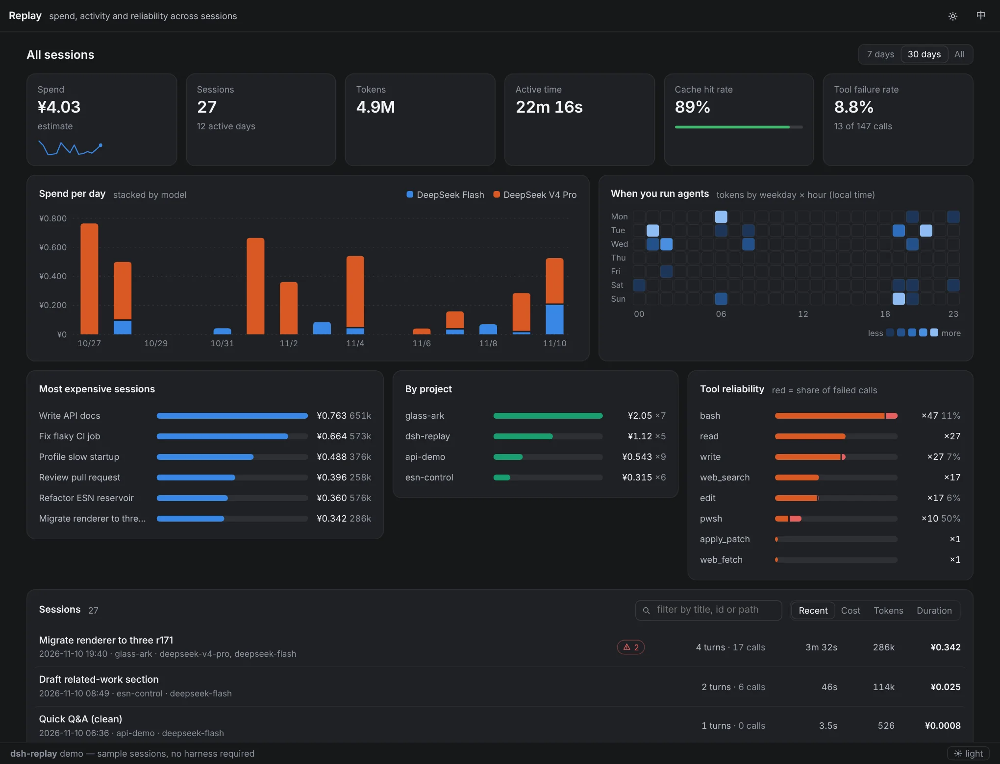

<div align="center">


# dsh-replay

**Trajectory shows the process. Replay gives you the verdict.**<br/>
A session report for DeepSeek Harness: what it cost, where the time went, what failed, which files changed, whether anything risky ran — then share it, redacted, in one click.

[](https://github.com/MingoZhou/dsh-replay/actions/workflows/ci.yml)
[](https://www.npmjs.com/package/@mingozhou/dsh-replay)
[](./LICENSE)
[](https://github.com/topics/dsh-plugin)

[简体中文](./README.md) | **English**

[Live demo](https://mingozhou.github.io/dsh-replay/) · [Install](#install) · [FAQ](#faq) · [Changelog](./CHANGELOG.md)



</div>

## How it relates to the built-in Trajectory tab

The harness's own Trajectory tab already does "inspect one run, turn by turn" well. Replay does not redo that; it answers the questions Trajectory leaves open.

| You want to know | Trajectory | Replay |
|---|---|---|
| What happened in this step, how long it took | ✅ its home turf | a timeline, good enough |
| What the run cost (CNY, peak / off-peak) | — | ✅ |
| Was it healthy: failures, retries, loops, aborted turns | — | ✅ run score + "needs attention" |
| Which files changed, and the diffs | — | ✅ |
| Risky commands, touched secrets (PowerShell included) | — | ✅ |
| Spend this week, costliest project, flakiest tool | — | ✅ all-sessions dashboard |
| Send it to someone without a harness | — | ✅ redacted single-file HTML / Markdown summary |
| How two runs differ | — | ✅ side-by-side tool sequence |

> "Replay" means **looking back** at a run that already happened. It never re-sends a session to the model and costs nothing. To re-run from a point, select an event in the timeline and press **Fork here**, then continue the new session in the harness.

## The story

<details>
<summary><b>How dsh-replay got here</b>: from "no viewer at all" to "the report on top of Trajectory"</summary>

<br/>

**0.1 – 0.3: a viewer for a log nobody could read.**
DeepSeek Harness writes every session to an append-only log in which everything that reached the model can be rebuilt. At the time, though, it shipped no way to look at that log. The questions kept coming back after every long run: *it ran for hours and burned millions of tokens, on what? Which call was stuck? Did it touch my `.env`? What did this cost me?* dsh-replay started as the missing viewer: a timeline you could scrub, a token chart, a cost estimate, a rule-based audit, a fork tree and a one-file HTML export.

**0.4: listed in awesome-dsh-plugins.**
The plugin was published to npm as a one-command install, was picked up by the awesome-dsh-plugins list, and was featured by Zhihu Daily.

**Harness rc.8: the official Trajectory tab.**
The harness then shipped its own Trajectory tab. It is very good at the thing dsh-replay started with: turn-by-turn inspection, timing per record, live following and paging through long sessions. There was no point in competing with it, and the plugin went quiet after a compatibility fix (0.4.1).

**1.0: the questions Trajectory doesn't answer.**
Instead of a second step-by-step viewer, 1.0 turns dsh-replay into the report you read *after* a run, on top of Trajectory. None of the following is in the official tab:

- **Cost in CNY**, priced step by step with the model that answered and the peak / off-peak tariff in force at that moment, with a breakdown by model and by input / output / cache.
- **A run score and a "needs attention" list**: repeated-call loops, failed calls, slow calls, model retries, aborted turns, each one click away from the event.
- **Where the time went**: a swimlane of model time, tool time and idle time at real durations.
- **Files changed**, with diffs rebuilt from `write` / `edit` / `apply_patch`.
- **A recalibrated audit** that treats PowerShell as a real shell and judges a delete by what it deletes.
- **An all-sessions dashboard**: spend per day, per project and per model, and which tools fail most.
- **Redacted sharing**: one HTML file or a Markdown summary, with keys and home paths masked first.
- **Compare** two runs call by call, and **fork** a new session from any event.

The full list of changes is in [CHANGELOG.md](./CHANGELOG.md).

</details>

<details>
<summary><b>Why it helps when you vibe code</b></summary>

<br/>

Vibe coding means letting the agent drive and approving as it goes. That works until you try to remember what happened. After a long session you have usually lost track of three things, and dsh-replay is built to give them back:

- **What you said yes to.** Twenty approvals in, they blur together. The audit lists every risky operation in the run (recursive deletes, `curl | sh` and `iwr | iex`, `sudo`, force pushes, credentials typed on the command line, writes to `.env` or `~/.ssh`), ranked by severity, and each finding opens the exact event so you can check what ran and whether you approved it.
- **Where the agent spent its time.** The swimlane and the "needs attention" list show it directly: the test suite it re-ran four times with the same arguments, the install that took two minutes, the hour that was really you away from the keyboard.
- **Where the money went.** Tokens are split into uncached input, cache reads, cache writes and output, then priced per model and per tariff, so you can see that most of the bill was one expensive model at peak hours, or how much the cache saved. The context chart shows the prompt growing step by step and where compaction cut it back.

The dashboard then adds the longer view: what you spent this week, which project costs the most, and which tool fails most often.

</details>

## Features

### Report

- **Run score** (0–100), built only from the deductions it lists: critical / serious audit findings, failed tool calls, repeated-call loops, model retries, abnormal turn ends. No deductions means 100.
- **Six headline numbers** — cost, active time, tokens, cache hit rate, tool calls, turns / steps — each compared with the median of your last 10 sessions.
- **Where the time went**: a swimlane at real durations (user / model / tool), failed calls in red, idle gaps folded. Click any block to open it in the timeline.
- **Cumulative cost / tokens** and **context size per step** (compactions are visible as drops).
- **Needs attention**: loops, failed calls, slow calls, retries and aborted turns, all clickable.

### Cost in CNY

- DeepSeek defaults follow the official CNY price page, with **separate peak and off-peak rates**; every step is priced with the model that answered it and the tariff in force at that moment.
- The table is editable in the UI (⚙). USD-quoted models convert at a configurable rate; you can switch the whole display to USD.
- Every amount is an estimate — your bill is the source of truth.

### All sessions

Spend, tokens, active time, cache hit rate and tool failure rate; daily spend stacked by model; a weekday × hour heatmap; the most expensive sessions; per-project totals; failure share per tool. Summaries are folded and cached on the host, so the browser never downloads every log.



### Timeline

Virtualised, so long sessions stay fast. Shows reasoning, renders Markdown, folds JSON, and draws diffs for `edit` / `write` / `apply_patch`.

Keys: <kbd>J</kbd>/<kbd>K</kbd> move, <kbd>[</kbd>/<kbd>]</kbd> previous / next turn, <kbd>E</kbd> next failure, <kbd>Space</kbd> play, <kbd>/</kbd> search, type `#123` to jump to a seq.

### Files

Rebuilds "what did this session change" from the `write` / `edit` / `apply_patch` calls in the log, with per-operation diffs. (Changes made through shell commands are not visible.)

### Audit

- `bash` and `pwsh` / `powershell` are both first-class: `rm -rf`, `Remove-Item -Recurse`, `curl | sh`, `iwr | iex`, `sudo`, `Set-ExecutionPolicy`, force pushes, credentials on the command line, and more.
- A recursive delete is judged by **what it deletes**: wiping `node_modules` / `dist` is info; a path outside the workspace is critical.
- Ordinary shell commands are info, grouped by rule and folded. Any rule can be ignored with one click.

### Share

A redaction preview comes first: API keys, tokens, secret assignments, passwords in URLs and home-directory user names are masked (e-mail addresses optionally). Export the whole session, one turn, or a seq range.

- **HTML export**: one self-contained file that opens offline.
- **Markdown summary**: for an issue, a chat or a post.

Redaction is pattern-based and best-effort — skim an export before posting it publicly.

### Also

- **Live follow** while a session is running (polls every 2.5 s; pausable).
- **Compare**: paired metrics and an aligned tool sequence that marks where two runs start to differ.
- **Forks**: fork families and subagents. Since harness 0.2 a fork no longer records its source, so those edges are inferred from the shared first prompt and labelled as such.
- English / 中文; light and dark follow the harness theme.

## Install

Not ready to install? Try the [live demo](https://mingozhou.github.io/dsh-replay/) on sample sessions.

Pick the way you run the harness:

<details open>
<summary><b>A. Desktop app (you installed the harness from an installer)</b></summary>

<br/>

1. Open the harness desktop app and go to the plugin store on the **Plugins** page.
2. Search for `@mingozhou/dsh-replay`.
3. Click **Install** and restart the harness when asked.

No command line and no Node.js needed.

</details>

<details>
<summary><b>B. Harness from source (you cloned the harness repo and run <code>pnpm dsh web</code>)</b></summary>

<br/>

Run this **inside the harness repo** (the profile mounted by `pnpm dsh web` is named `web`):

```bash
pnpm dsh plugin --profile web add @mingozhou/dsh-replay
```

Check that it is there:

```bash
pnpm dsh --profile web --dump-config
# look for a `# == @mingozhou/dsh-replay` section
```

Then **fully restart**:

```bash
pnpm dsh web
```

and open http://127.0.0.1:3080 .

</details>

<details>
<summary><b>C. Release CLI (installed with <code>npm i -g @deepseek-ai/dsh</code>)</b></summary>

<br/>

```bash
ls ~/.dsh/profiles                                   # list your profiles
dsh plugin --profile <your-profile> add @mingozhou/dsh-replay
dsh --profile <your-profile> --dump-config           # look for # == @mingozhou/dsh-replay
dsh web --profile <your-profile>                     # restart
```

On Windows the profiles live in `C:\Users\<you>\.dsh\profiles\`.

</details>

<details>
<summary><b>D. Hacking on dsh-replay itself: install from this repo</b></summary>

<br/>

```bash
git clone https://github.com/MingoZhou/dsh-replay && cd dsh-replay
npm install && npm run build      # lib/ is a build product
npm run demo                      # local demo → http://localhost:4173

# point the profile at this folder instead of the npm package (absolute path)
pnpm dsh plugin --profile web add /absolute/path/to/dsh-replay
```

</details>

### Where to find it

After the restart there are two entry points:

1. **Session Replay** at the bottom of the sidebar opens the all-sessions dashboard full screen.
2. A **Replay** tab in every session view, next to Trajectory, opens that session's report.

### Upgrading to 1.0

- **Desktop app**: uninstall dsh-replay in the plugin store, then search for `@mingozhou/dsh-replay` and install again.
- **Source / CLI**: remove, then add:

  ```bash
  pnpm dsh plugin --profile web remove dsh-replay
  pnpm dsh plugin --profile web add @mingozhou/dsh-replay
  ```

You are on 1.0 when the tab bar shows **Report** and **Files**. A USD price table saved in the browser by an older version is not carried over; 1.0 prices in CNY by default.

### Compatibility

1.0 is written against session log format v4 (harness 0.2.x) and still reads older logs. The harness is in preview and its plugin API moves; if an upgrade breaks something, please open an issue with your harness version.

### Configuration

Two options in `cordis.patch.yml`:

| Option | Default | Meaning |
|---|---|---|
| `routePrefix` | `/replay/api` | prefix of the read-only HTTP API |
| `summaryLimit` | `300` | how many recent sessions the dashboard summarises |

The pricing table, ignored audit rules and redaction choices live in the browser (localStorage).

### Uninstall

- **Desktop app**: uninstall it in the plugin store.
- **Source / CLI**:

  ```bash
  pnpm dsh plugin --profile web remove dsh-replay         # harness from source
  dsh plugin --profile <your-profile> remove dsh-replay   # release CLI
  ```

Restart the harness. The plugin writes no state anywhere else. As a last resort, open the profile folder, remove `dsh-replay` from both `dependencies` **and** `dsh.profile.bundles` in its `package.json`, run `pnpm install` there and restart.

## FAQ

**Does "replay" re-send the session to the model?** No. Replay only reads the log; it never calls a model and costs nothing. To re-run, use **Fork here** in the timeline.

**The amount doesn't match my bill.** Amounts are estimates from the price table. Check the prices and peak hours under ⚙ first; cache writes, provider credits and discounts all cause differences.

**I can't find it in the store.** Search for the full name `@mingozhou/dsh-replay`, including the `@` and the slash. If it still doesn't show up, your desktop app may be older; update the harness or use one of the command-line installs above.

**`GET /replay/api/sessions` returns 404.** The config layer did not apply. The harness fails silently on a plugin name it cannot resolve: re-run `dsh plugin add` and confirm with `--dump-config`.

**`Cannot find module '…/dsh-replay/lib/index.js'` on start.** The profile points at a source checkout and `lib/` is a build product. Run `npm install && npm run build` in the plugin folder.

**The API works but there is no sidebar button or Replay tab.** Make sure `lib/client.js` exists, then fully restart the harness — client plugins are scanned at start-up only.

**`EADDRINUSE: 127.0.0.1:3080` on start.** A previous harness instance is still running; close it first.

**There is no "Fork here" button.** It appears only inside the harness, and needs the host's client `sessions` service; the demo and exported files don't have it.

**The dashboard is slow the first time.** The first open folds every session log into a summary; later opens hit the cache. Lower `summaryLimit` if you have a great many sessions.

## Architecture

```
src/core/      zero-dependency analysis: decode, timeline, cost, audit, insights, files, redact, summary, compare
src/index.ts   host half: read-only HTTP API (sessions, incremental events, cached summaries, viewer)
src/client/    browser half: React UI; charts are hand-written SVG, no chart library
demo/          standalone demo and sample logs (also the test fixtures)
```

`core` works on its own: `import { parseSessionJsonl, buildTimeline, estimateCost, auditSession } from '@mingozhou/dsh-replay/core'`.

Surfaces, ink, borders and hover states all use the harness's `--dsw-alias-*` theme tokens, so the plugin follows theme and dark-mode changes; only the data colours inside charts are its own.

```bash
npm test             # unit tests
npm run screenshots  # regenerate README screenshots (needs `npm run demo` running)
```

## License & credits

MIT. Jing Xiaoshen (鲸小深) is an original character made for this project, not an official DeepSeek logo. The UI embeds `assets/mascot-192.webp` (192 px, about 8 KB); replace it and `npm run build` embeds yours — anything over 60 KB is refused and the built-in SVG is used instead.
