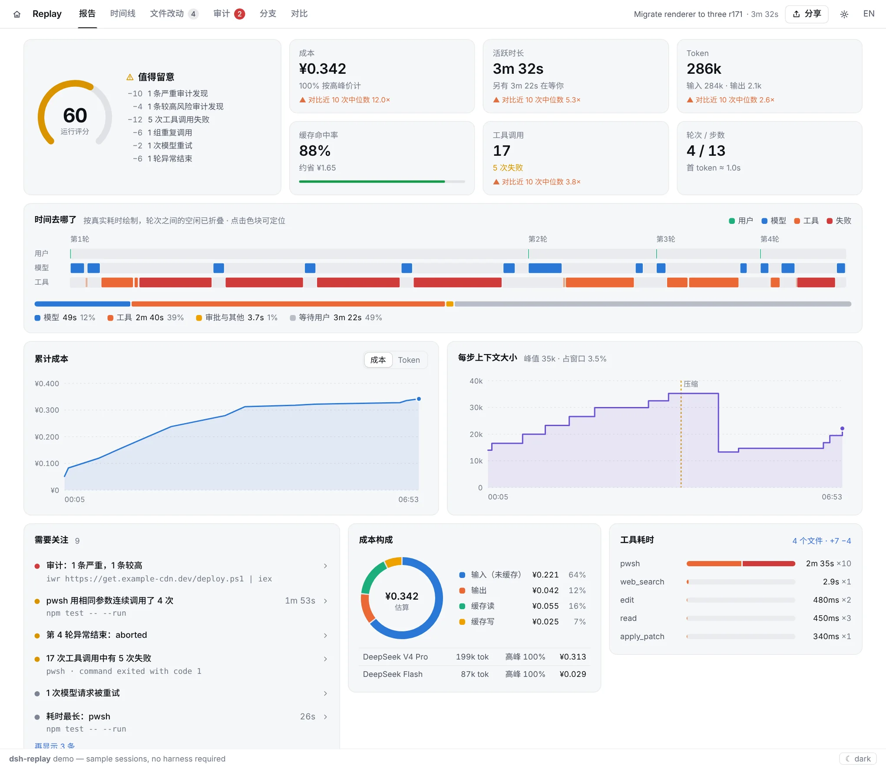
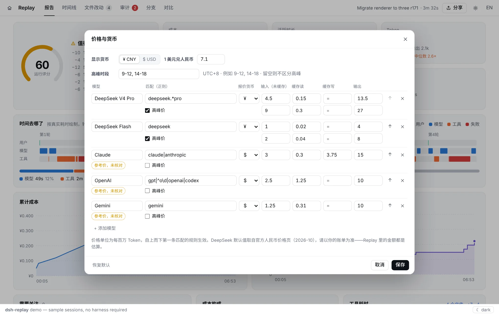
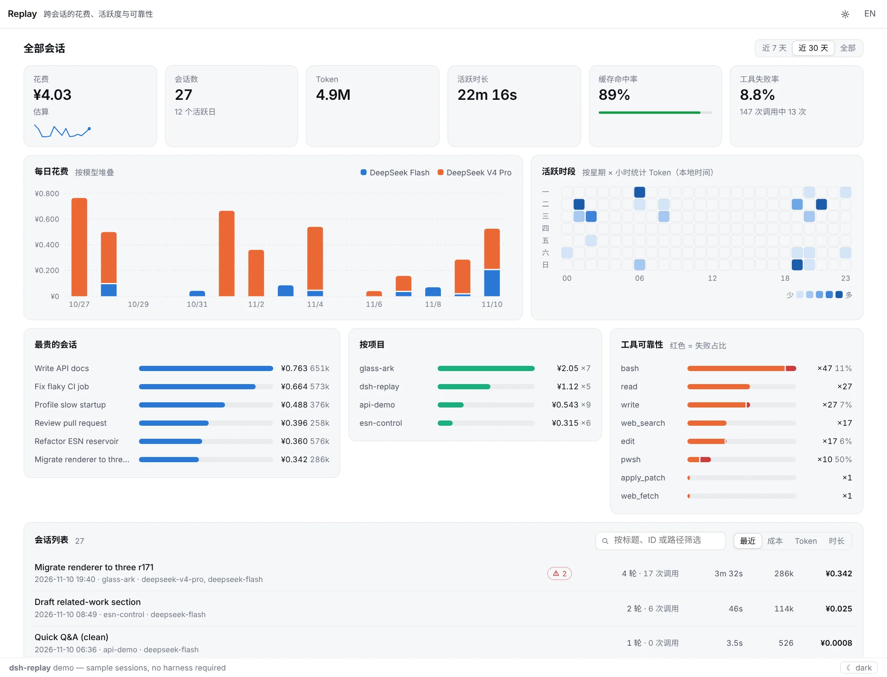
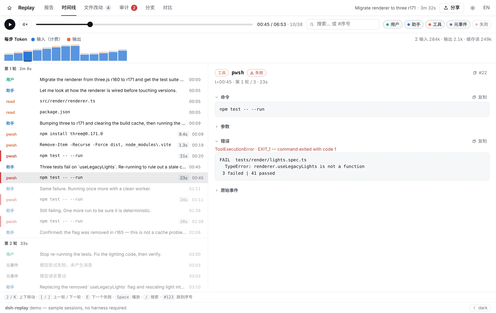
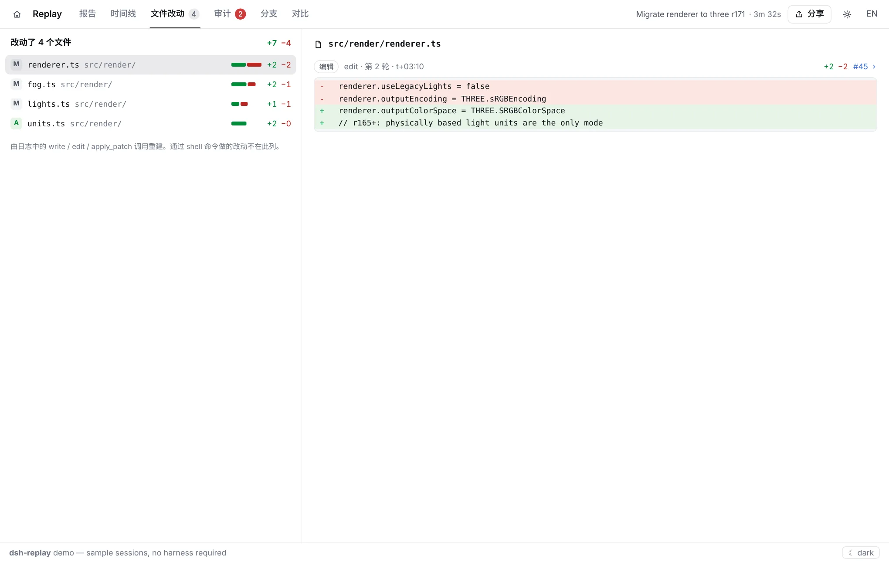
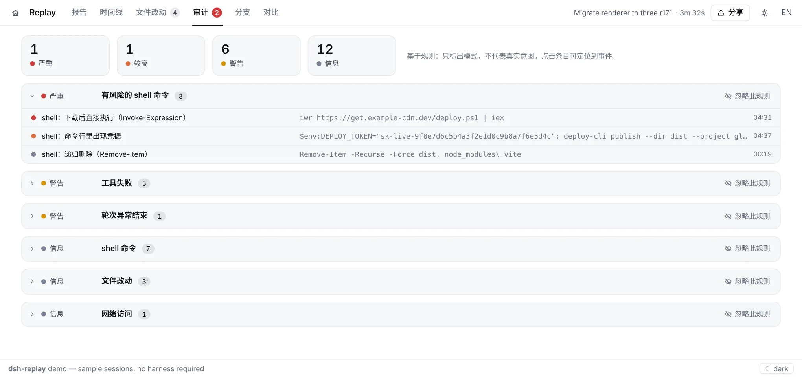
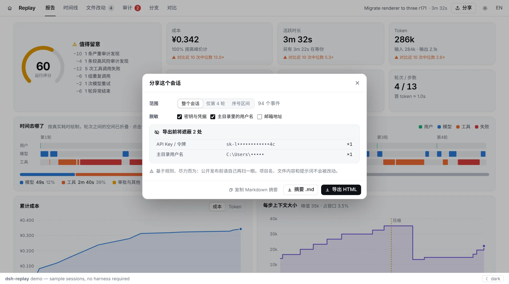

<div align="center">


# dsh-replay

**轨迹看过程，Replay 看结论。**<br/>
给 DeepSeek Harness 会话出一份复盘报告：花了多少钱、时间去哪了、哪里出了错、改了哪些文件、有没有危险操作——然后脱敏后一键分享。

[](https://github.com/MingoZhou/dsh-replay/actions/workflows/ci.yml)
[](./LICENSE)
[](https://github.com/topics/dsh-plugin)

**[在线 Demo](https://mingozhou.github.io/dsh-replay/)** · [English](./README.md) · [安装](#安装) · [常见问题](#常见问题)



</div>

## 它和官方【轨迹】是什么关系

Harness 自带的【轨迹】标签页已经把“逐轮、逐调用地看一次运行”做得很好。Replay 不重复这件事，它回答的是轨迹不回答的问题：

| 你想知道 | 官方【轨迹】 | Replay |
|---|---|---|
| 这一步发生了什么、耗时多久 | ✅ 主场 | 有时间线，够用 |
| 这次运行花了多少钱（人民币，分高峰 / 低谷） | — | ✅ |
| 整体健康吗：失败、重试、死循环、异常结束 | — | ✅ 运行评分 + 需要关注 |
| 改了哪些文件，diff 是什么 | — | ✅ |
| 有没有危险命令、碰没碰密钥（含 PowerShell） | — | ✅ |
| 这周一共花了多少、哪个项目最烧钱、哪个工具老失败 | — | ✅ 全部会话面板 |
| 发给别人看，对方不用装 Harness | — | ✅ 脱敏后导出单个 HTML / Markdown 摘要 |
| 两次运行差在哪 | — | ✅ 工具序列并排对比 |

> “Replay”指**回看**一次已经发生的运行，不会把会话重新发给模型。想从某一步重新跑：在时间线里选中事件，点 **从这里分叉**，然后在 Harness 里继续那个新会话。

## 功能

### 报告

打开会话先看到结论，而不是几百行事件。

- **运行评分**（0–100）：只由列出来的扣分项构成——严重/较高审计发现、工具失败、重复调用、模型重试、异常结束。没有扣分项就是 100。
- **六个指标**：成本、活跃时长、Token、缓存命中率、工具调用、轮次/步数。每个都和你最近 10 次会话的中位数对比。
- **时间去哪了**：按真实耗时画的泳道图（用户 / 模型 / 工具），失败的调用标红，轮次之间的空闲被折叠。点任何色块跳到时间线。
- **累计成本 / Token**、**每步上下文大小**（能直接看到压缩发生在哪）。
- **需要关注**：死循环（同工具同参数连续调用）、失败的调用、慢调用、重试、异常结束的轮次，全部可点击定位。

### 成本按人民币算

- DeepSeek 默认价格取自官方人民币价格页，**区分高峰 / 低谷时段**，按每一步实际使用的模型和发生时间计价。
- 价格表可在界面里改（⚙），支持美元报价的模型按汇率折算，也可以整体切到美元显示。
- 所有金额都是估算，以账单为准。



### 全部会话

花费、Token、活跃时长、缓存命中率、工具失败率；每日花费按模型堆叠；星期 × 小时热力图；最贵的会话；按项目汇总；各工具的失败占比。汇总在宿主侧计算并缓存，浏览器不会下载每个会话的完整日志。



### 时间线

虚拟滚动，长会话不卡。支持推理过程、Markdown 渲染、JSON 折叠、`edit` / `write` / `apply_patch` 的 diff 视图。

键盘：<kbd>J</kbd>/<kbd>K</kbd> 上下，<kbd>[</kbd>/<kbd>]</kbd> 上一轮/下一轮，<kbd>E</kbd> 下一个失败，<kbd>Space</kbd> 播放，<kbd>/</kbd> 搜索，输入 `#123` 跳到序号。



### 文件改动

从日志里的 `write` / `edit` / `apply_patch` 调用重建“这次改了哪些文件”，带逐次 diff。（通过 shell 命令做的改动看不到。）



### 审计

- `bash` 和 `pwsh` / `powershell` 都是一等公民：`rm -rf`、`Remove-Item -Recurse`、`curl | sh`、`iwr | iex`、`sudo`、`Set-ExecutionPolicy`、强推、命令行里的凭据……
- 递归删除看的是**删什么**：清 `node_modules` / `dist` 是信息级，删工作区外的路径才是严重。
- 普通 shell 命令只是信息级，按规则分组折叠；不想看的规则可以一键忽略。



### 分享

导出前先看脱敏预览：API Key、令牌、凭据赋值、URL 里的密码、主目录里的用户名都会被遮蔽（邮箱可选）。可以只导出某一轮或一段序号区间。

- **导出 HTML**：单个文件，离线可看，对方不需要 Harness。
- **Markdown 摘要**：贴进 issue、群聊或文章。

脱敏基于规则，尽力而为；公开发布前请自己再看一眼。



### 还有

- **实时跟随**：会话还在运行时，Replay 每 2.5 秒拉取新事件，报告和时间线跟着更新；可暂停。
- **对比**：两次运行的指标成对比较，工具调用序列并排对齐，标出从哪一步开始不同。
- **分支**：分叉家族与子 Agent。Harness 0.2 起分叉不再记录来源，这类连线由“首条提示相同”推断，并标注为“推断”。
- 中英双语；明暗主题跟随 Harness。

## 安装

**先试试：** [在线 Demo](https://mingozhou.github.io/dsh-replay/)，示例会话，零安装。

```bash
# 发行版 CLI（npm i -g @deepseek-ai/dsh）；查看已有 profile：ls ~/.dsh/profiles
dsh plugin --profile <你的profile> add @mingozhou/dsh-replay

# 从源码仓库跑的 Harness（在 harness 仓库目录里执行）
pnpm dsh plugin --profile web add @mingozhou/dsh-replay
```

用 `dsh --profile <你的profile> --dump-config` 验证（应出现 `# == @mingozhou/dsh-replay` 一段），然后**完全重启** Harness。你会得到两个入口：

1. 侧栏左下角的 **会话回放** 按钮：全屏打开“全部会话”面板；
2. 每个会话视图里的 **Replay** 标签页：直接打开这个会话的报告。

### 兼容性

1.0 按会话日志格式 v4（Harness 0.2.x）编写，同时兼容更早格式的日志。Harness 仍在 preview 阶段，插件 API 会变；如果升级后出问题，请带上 Harness 版本号开 issue。

### 从源码安装

```bash
git clone https://github.com/MingoZhou/dsh-replay && cd dsh-replay
npm install && npm run build      # lib/ 是构建产物，每次重新 clone 后都要构建
npm run demo                      # 本地 demo → http://localhost:4173
dsh plugin --profile <你的profile> add <插件绝对路径>/dsh-replay
```

### 配置

`cordis.patch.yml` 里可调两项：

| 项 | 默认 | 说明 |
|---|---|---|
| `routePrefix` | `/replay/api` | 只读 HTTP 接口的前缀 |
| `summaryLimit` | `300` | “全部会话”面板统计最近多少个会话 |

价格表、忽略的审计规则、脱敏选项保存在浏览器本地（localStorage）。

### 卸载

```bash
dsh plugin --profile <你的profile> remove dsh-replay
pnpm dsh plugin --profile web remove dsh-replay   # 源码模式
```

然后重启 Harness。插件不在其他任何地方写入状态。

## 常见问题

**“回放”是把会话重新发给模型吗？** 不是。Replay 只读日志，不调用模型，不产生费用。要重跑，用时间线里的 **从这里分叉**。

**金额和账单对不上。** 金额是按价格表估算的。先在 ⚙ 里核对价格和高峰时段；缓存写入、服务商的赠送额度和折扣都可能造成差异。

**`GET /replay/api/sessions` 返回 404。** 配置层没生效。Harness 对无法解析的插件名是静默失败：重跑 `dsh plugin add`，并用 `--dump-config` 确认。

**启动报 `Cannot find module '…/dsh-replay/lib/index.js'`。** profile 指向的是源码目录，而 `lib/` 是构建产物。进插件目录跑 `npm install && npm run build`。

**接口正常但没有侧栏按钮或 Replay 标签页。** 确认 `lib/client.js` 存在，然后完全重启 Harness：客户端插件只在启动时扫描。

**看不到“从这里分叉”按钮。** 这个按钮只在 Harness 里出现，并且需要宿主提供客户端 `sessions` 服务；Demo 和导出的 HTML 里没有。

**“全部会话”第一次打开很慢。** 第一次要把每个会话的日志折叠成汇总，之后走缓存。会话很多时可以调小 `summaryLimit`。

## 架构

```
src/core/      零依赖分析层：解码、时间线、成本、审计、体检、文件改动、脱敏、汇总、对比
src/index.ts   宿主半：只读 HTTP 接口（会话、增量事件、汇总缓存、查看器）
src/client/    浏览器半：React 界面，图表为手写 SVG，无第三方图表库
demo/          独立 Demo 与示例日志（也是测试夹具）
```

`core` 可以单独使用：`import { parseSessionJsonl, buildTimeline, estimateCost, auditSession } from '@mingozhou/dsh-replay/core'`。

界面的底色、文字、边框、悬停全部使用 Harness 的 `--dsw-alias-*` 主题变量，所以换主题、切暗色都会跟着变；只有图表里的数据色是插件自己的。

```bash
npm test             # 单元测试
npm run screenshots  # 重新生成 README 截图（需要先 npm run demo）
```

## 许可与致谢

MIT。鲸小深是为本项目创作的原创角色，不是 DeepSeek 官方 logo。界面里嵌入的是 `assets/mascot-192.webp`（192 px，约 8 KB）；换成你自己的图后 `npm run build` 会自动嵌入，超过 60 KB 会被拒绝并回退到内置 SVG。
