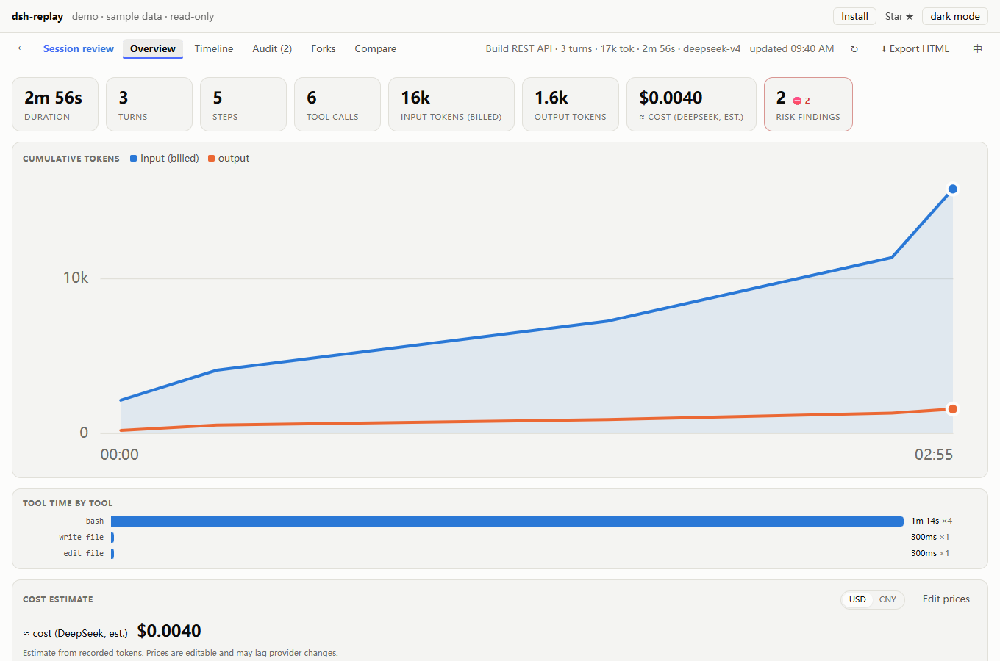
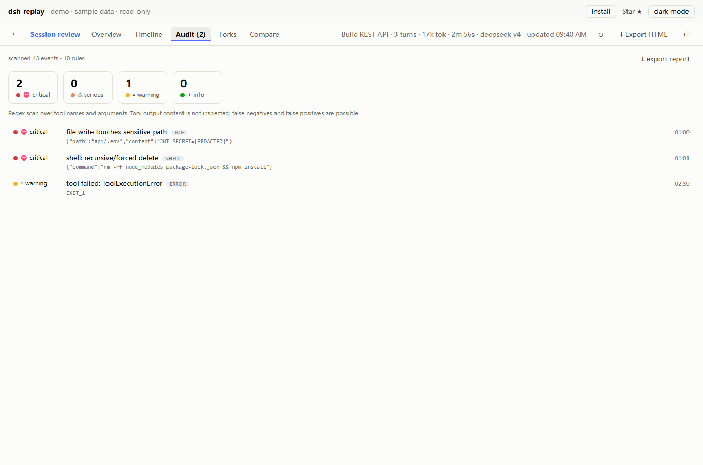
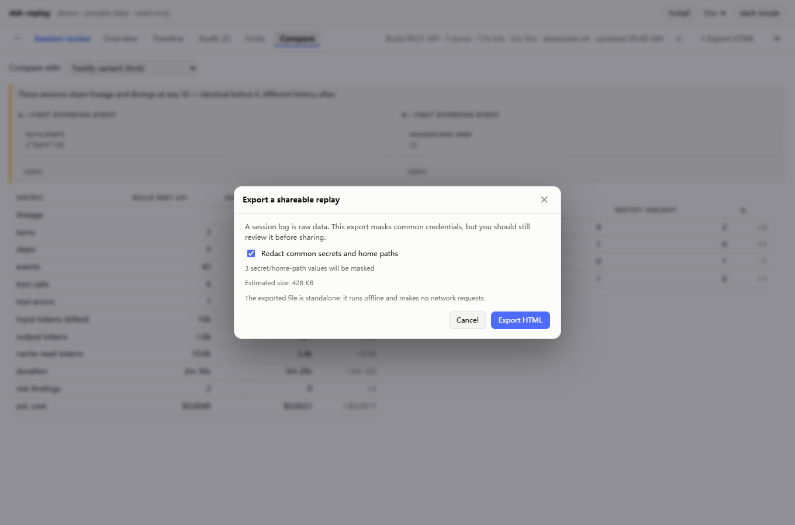

# Replay is not a rerun: the autopsy of an agent session

> Draft for publication. The “5 hours / 18M tokens / 87 tool calls” numbers are illustrative — replace them with your own session and screenshots before posting. Images: `assets/overview-light.png`, `assets/audit-light.png`, `assets/export-light.png`.

You come back after lunch and see a session that:

- ran for **5 hours**,
- burned **18M tokens**,
- made **87 tool calls**,
- and ended with “Done.”

What did it actually do? Where did the money go? Did it touch `.env`? And if a teammate asks to see it, are you supposed to hand them your whole Harness?

That is the problem dsh-replay is built for. But first, the question I keep getting — including the real GitHub issue:

> **Does “replay” mean sending the session back to the model?**

No. Replay is read-only. It makes no model request, spends no tokens, and writes nothing. It reads the append-only log and renders it as a timeline. It is a recording, not a rematch.

## Cut one: where the money went

Most token counters tell you input and output. A long session may switch models halfway through, and cache hit rates move. Charging every token at one rate produces a number nobody trusts.

dsh-replay accumulates usage per model, estimates cache-aware cost, and lets you edit the price table:

It is not a bill. It is an estimate from recorded tokens — enough to answer “where did this month go?”

## Cut two: did it do anything dangerous?

This is the page I use most. It scans tool names and arguments for:

- recursive/forced deletes,
- reads or writes of `.env`, `~/.ssh`, private keys,
- credentials written into files,
- API keys in tool output,
- network requests that may carry sensitive data,
- sandbox/permission changes and denied approvals.

Two details matter:

1. **The initial permission/sandbox state is baseline, not risk.** The old version flagged two serious findings on every session; after a while nobody looked. Now only a later change is reported.
2. **Windows is a first-class platform.** `pwsh`, `Remove-Item -Recurse -Force`, `iwr | iex` were invisible before 0.4.2. On Windows, the old audit was decoration.

## Cut three: how to show someone

The most practical feature is export. One button bakes a session into a single offline HTML file:

The other person needs no Harness, no network, no model. They can scrub the timeline, inspect tool arguments, see cost and audit findings.

The counter-intuitive part: **session logs are raw data and can contain real secrets.** Export now redacts common API keys, `.env` assignments, private keys and home paths by default, and tells you how many values will be masked and how large the file is. Unredacted export is an explicit opt-in.

## What about the official Trajectory view?

DSH 0.2.1-rc.2 ships **Trajectory**: a live, virtualized ledger for the current session, with tokens, thinking and the system prompt. dsh-replay does not compete for that.

dsh-replay is for **after the session**, and for **across sessions**:

- an archive dashboard for every session,
- spend by month/workspace,
- which sessions contain high-risk actions,
- where two forks actually diverge,
- turning one session into a file a teammate can open.

Trajectory is “now”. dsh-replay is “all of it, afterwards”.

## Try it

The fastest path on Desktop:

1. Open **Plugins** in the sidebar.
2. **Add plugin**.
3. Enter `@mingozhou/dsh-replay`.
4. Restart.

Or try the zero-install demo: https://mingozhou.github.io/dsh-replay/

Repo: https://github.com/MingoZhou/dsh-replay

If it saves you an afternoon of log spelunking, a ⭐ helps other DSH users find it.
