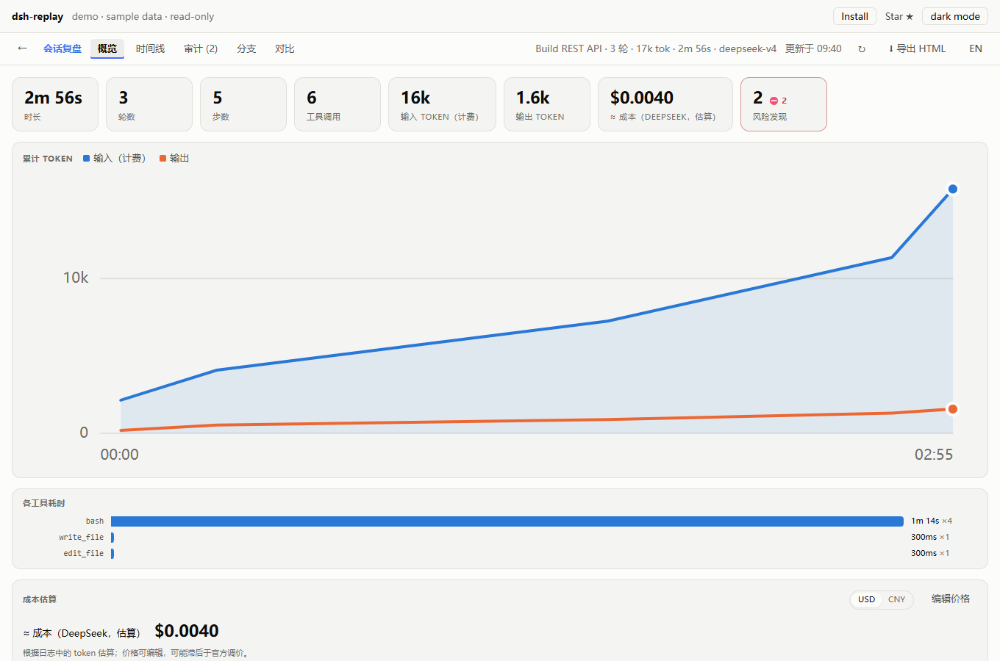
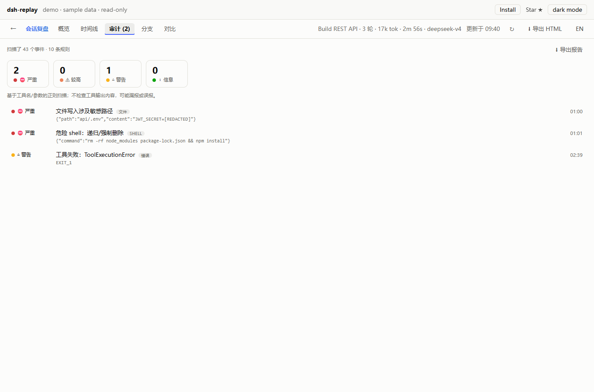
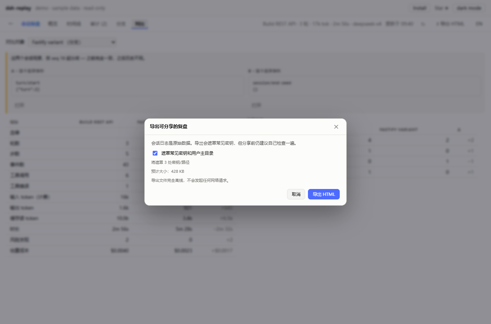

# 回放不是重跑：一次 Agent 会话的尸检报告

> 这是一篇可直接发布的草稿。文中的“5 小时 / 1800 万 token / 87 次工具调用”是叙事示例，发布前请替换成你自己的真实会话数字和截图。截图位置在 `assets/overview-zh.png`、`assets/audit-zh.png`、`assets/export-zh.png`。

周一早上，你打开 DeepSeek Harness，看到一个会话：

- 跑了 **5 个小时**
- 烧了 **1800 万 token**
- 调用了 **87 次工具**
- 最后只留下一句“已完成”

它到底干了什么？钱花在哪？有没有碰过 `.env`？如果同事问“给我看看”，你总不能把整个 Harness 发给他。

这就是 dsh-replay 想解决的问题。但先澄清一个被问了很多次的问题——包括 GitHub 上真实存在的 issue：

> **“回放”是指把 session 重新发给模型吗？**

不是。回放全程不调用模型、不消耗 token、不写入日志。它只是把 append-only 的会话日志读出来，在浏览器里还原成一条可拖动的时间线。像看比赛录像，不是重赛。

## 第一刀：钱到底花在哪

大多数“token 统计”只告诉你输入多少、输出多少。但一个长会话往往中途换过模型，缓存命中率也在变。把所有 token 乘一个单价，很容易算出一个你自己都不信的数字。

dsh-replay 的成本页按模型分别累计，给出缓存感知的估算，并允许你改价格表：

它不会假装这是账单——只是一个根据日志估算的“这次大概花了多少”，但足够回答“这个月钱去哪了”。

## 第二刀：有没有干危险的事

这是我最常用的页面。它会扫工具名和参数，标出：

- 递归/强制删除
- 读取或写入 `.env`、`~/.ssh`、私钥
- 凭据被写进文件
- 工具输出里出现 API key
- 网络请求可能携带敏感数据
- 沙箱/权限变更、被拒绝的审批

这里有两个细节很重要：

1. **会话初始的 permission/sandbox 是基线，不是风险。** 旧版每个会话都报 2 条 serious，久而久之就没人看了。现在只有“后续发生变化”才报。
2. **Windows 也是人。** `pwsh`、`Remove-Item -Recurse -Force`、`iwr | iex` 这些以前完全不在规则里；0.4.2 补上了。否则在 Windows 上，审计只是一个摆设。

## 第三刀：怎么给同事看

最实用的功能其实是导出。一个按钮，把一个会话烤进单个离线 HTML：

对方不需要装 Harness、不需要联网、不需要模型。打开就能拖动时间线、看工具参数、看成本、看审计。

但这里有个反直觉的点：**会话日志是原始数据，里面可能有真密钥。** 所以 0.4.2 的导出默认脱敏——常见 API key、`.env` 赋值、私钥、用户主目录——并在导出前告诉你遮罩了多少处、文件多大。未脱敏导出需要手动勾选。

## 那官方 Trajectory 呢？

DSH 0.2.1-rc.2 已经内置了 **Trajectory（轨迹）** 视图，当前会话的实时账本、逐条 token、思考、系统提示词都做得很好。dsh-replay 不跟它抢这个场景。

dsh-replay 做的是**会话结束之后**、以及**跨会话**的事：

- 所有会话的档案仪表盘
- 这个月/这个工作区花了多少
- 哪些会话有高危操作
- 两个 fork 到底从哪个事件开始分岔
- 把一次会话变成同事能打开的文件

一句话：Trajectory 看“现在”，dsh-replay 看“所有”和“之后”。

## 怎么试

Desktop 最快：

1. 侧栏 **插件**
2. **Add plugin**
3. 输入 `@mingozhou/dsh-replay`
4. 安装后重启

也可以先看零安装的在线 demo：https://mingozhou.github.io/dsh-replay/

项目：https://github.com/MingoZhou/dsh-replay

如果它帮你省下了一个下午的翻日志时间，点个 Star 就是最大的支持。
